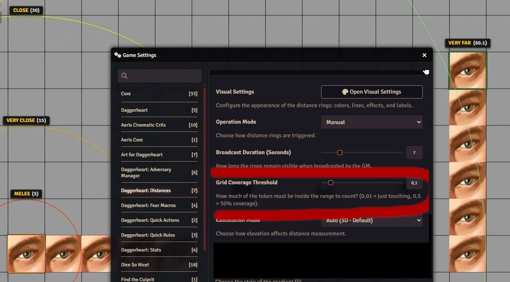
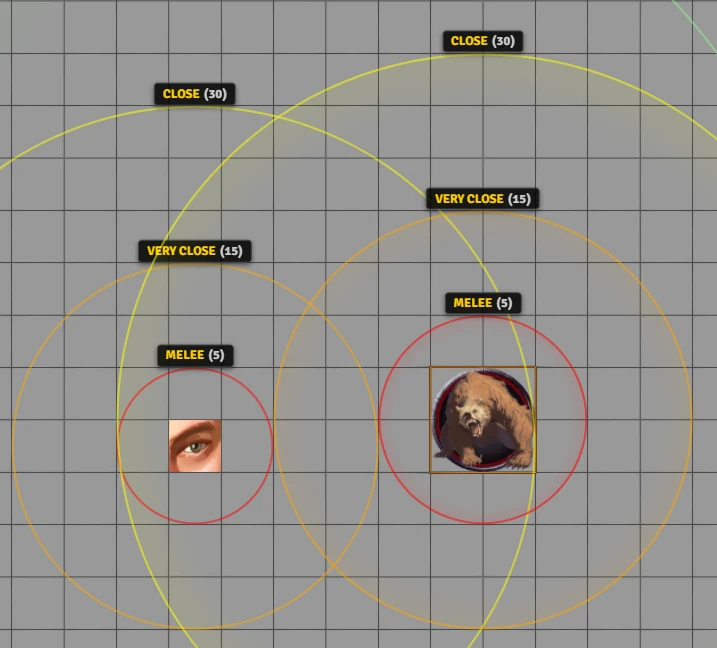
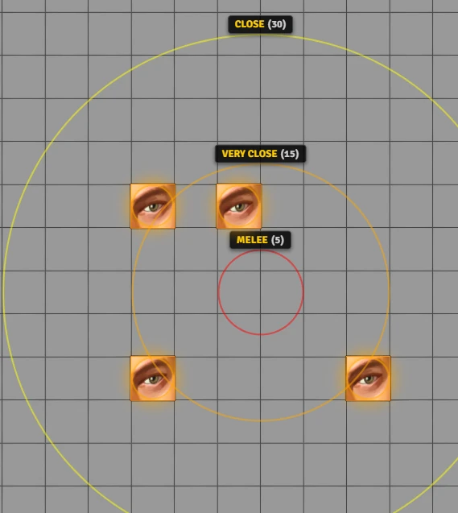
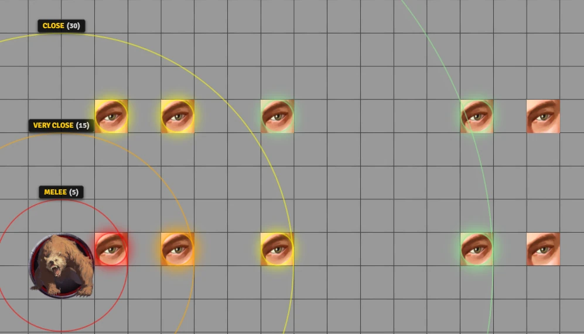
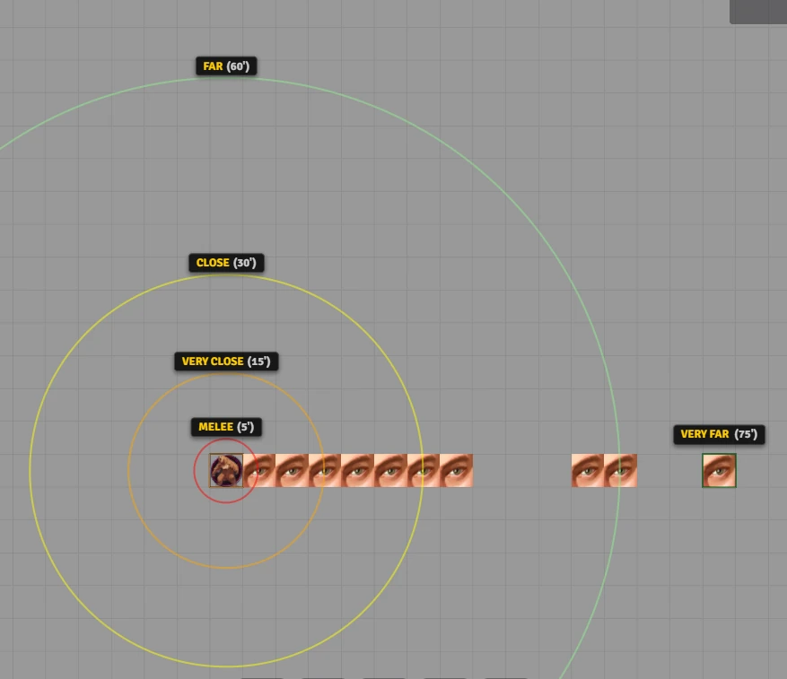
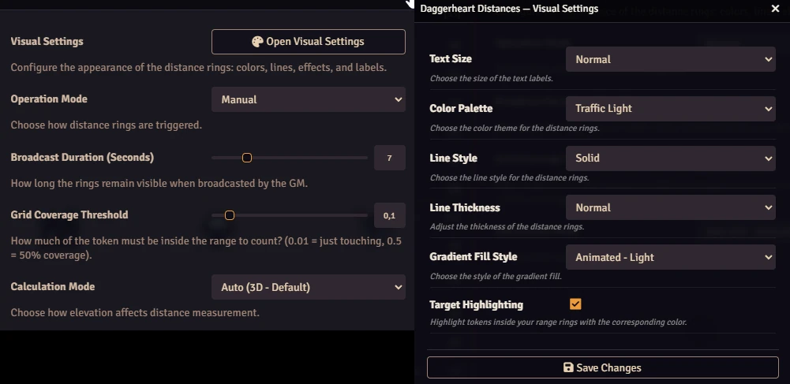

# Daggerheart: Distances

A visual and intuitive utility for the **Daggerheart** system in Foundry VTT. It automatically displays distance rings (Melee, Very Close, Close, Far) around tokens and calculates distances between characters instantly, helping players and GMs visualize combat ranges without needing to measure manually.

<video src="https://github.com/user-attachments/assets/c6e6a905-9cd4-4666-b742-9719f91a0a7b" 
       controls 
       width="720"
       autoplay 
       loop 
       muted></video>

[](https://buymeacoffee.com/mestredigital) [](https://mestredigital.online/pages/projetos-en)

> Leia em [Português do Brasil](docs/README-PTBR.md)

## 🌟 Key Features

### 📏 For Everyone (Players & GM)

* **Visual Range Rings:** Instantly see the 4 main range bands of Daggerheart:

  * **Melee:** 5 ft.

  * **Very Close:** 15 ft.

  * **Close:** 30 ft.

  * **Far:** 60 ft.

* **Smart Hover:** Hover your mouse over any token to see exactly how far it is from your character. No ruler needed!

* **Easy Toggle:** Turn the rings on or off quickly using a button in the Token HUD or a keyboard shortcut.

* **Smart Edge Detection:** Accurate for tokens of all sizes! The system measures distance from edge-to-edge rather than center-to-center. It also checks visual coverage: a token is only considered "in range" if a specific percentage of its body (configurable) is physically inside the ring, ensuring that what you see matches the rules.

**Set how much of a token must be inside the circle to be considered in range.**
<p align="center"></p>

**The system accounts for token size when calculating range.**
<p align="center"></p>

* **Mass Measurement:** Select multiple tokens and use the macro `game.modules.get("daggerheart-distances").api.massMeasurement();` to generate distance rings from the center of the group.
<p align="center"></p>

* **Target Highlighting:** Valid targets within range rings now glow with the ring's color.
<p align="center"></p>

* **Ghost Preview:** Range rings now follow the token preview while dragging to test positions.

### 📡 Broadcast — Share Rings with Everyone

The GM can show distance rings to **all connected players** at once. When you broadcast, the rings appear on every player's screen and disappear automatically after a configurable duration (default: 7 seconds).

This is perfect for highlighting a threat's reach during combat so the whole table is on the same page — no need to describe distances verbally.

**Three ways to broadcast:**

* **Keyboard:** Select a token and press **`Shift+R`**
* **Macro:** `game.modules.get("daggerheart-distances").api.toggle({ remote: true });`
* **Hover Broadcast Mode:** Enable it in settings and every token you hover will automatically broadcast to players (see Operation Mode below)

> **Note:** Only the GM can broadcast. Players pressing `Shift+R` have no effect.

### 🎮 Operation Mode — How Rings Are Triggered

You can change *how* rings appear by selecting an **Operation Mode** in the Module Settings:

| Mode | What it does |
|---|---|
| **Manual** *(default)* | Rings only appear when you press `R` or click the HUD button |
| **Hover Mode (GM)** | Rings appear automatically as the GM hovers over tokens — locally only |
| **Hover Mode (Broadcast)** | Same as above, but each hover broadcasts the rings to all players |

You can also **temporarily override** the active mode using hold-keys — useful when you're in Manual mode but want a quick broadcast without changing settings:

* **Hold `Shift+H`** — activates Hover Mode (GM) while the key is held
* **Hold `Shift+B`** — activates Hover Mode (Broadcast) while the key is held

Release the key and the mode returns to normal.

### 🎨 Customization

* **Beautiful Themes:** Choose from pre-made color palettes like "Traffic Light", "Neon Cyberpunk", or "Warm Sunset".

* **Visual Styles:** Configure the rings to have solid, dotted, or dashed lines, and adjust their thickness.

* **Immersive Effects:** Enable animated gradient fills that pulse gently, or keep it simple with static colors.

## ⚙️ How to Use

### Toggling Rings

<p align="center"></p>

You have many easy ways to show or hide the range rings around a token:

1. **Token HUD:** Right-click a token to open the HUD, then click the **Circle** icon (<i class="fas fa-circle-dot"></i>).

2. **Keyboard Shortcuts:**

| Shortcut | Action |
|---|---|
| `R` | Toggle rings on/off (local, just for you) |
| `Shift+R` | Broadcast rings to all players (GM only) |
| `M` | Mass Measurement from selected tokens |
| `Shift+Delete` | Clear all active rings at once |
| `Hold Shift+H` | Temporarily enable Hover Mode (GM) |
| `Hold Shift+B` | Temporarily enable Hover Mode (Broadcast) |

> All keybindings can be reassigned in **Foundry Settings → Configure Controls**.

3. You can also use macros. Every call goes through the module API:

```js
const api = game.modules.get("daggerheart-distances").api;
```

```js
api.toggle();              // Toggle rings for selected/hovered token
api.toggle({ remote: true }); // Broadcast rings to all players (GM only)
api.massMeasurement();     // Mass Measurement from selected tokens
api.clearAll();            // Remove all active rings (respects Clear All Mode setting)
```

```js
api.toggle({mode: '2d'}); // Calculates distance ignoring elevation.
```

```js
api.toggle({mode: '3d'}); // Calculates distance accounting for elevation.
```

```js
api.toggle({mode: 'both'}); // Shows both 3D and 2D distances.
```

```js
// GM only: explicit scope override (takes precedence over the Clear All Mode setting)
api.clearAll({ scope: 'all' });  // Remove rings for all connected players
api.clearAll({ scope: 'self' }); // Remove rings for the GM only
```

Other modules can ask Distances which range a token is in, using the same measurement as the rings. See [docs/API.md](docs/API.md).

### Configuration

Go to the **Module Settings** tab in Foundry VTT to customize the look and feel:

<p align="center"></p>

## 🚀 Installation

Install via the Foundry VTT Module browser or use this manifest link:

```js
https://raw.githubusercontent.com/brunocalado/daggerheart-distances/main/module.json
```

## 🌍 Translations

Want to translate this module into your language? Here's how:

1. Download the English translation file: [languages/en.json](https://github.com/brunocalado/daggerheart-distances/blob/main/languages/en.json)
2. Translate the values (keep the keys unchanged)
3. Submit your translation at [GitHub Issues](https://github.com/brunocalado/daggerheart-distances/issues) — attach the translated file and mention the target language

## 📜 Changelog

You can read the full history of changes in the [CHANGELOG](CHANGELOG.md).

## ⚖️ Credits and License

* **Code License:** [LICENSE](LICENSE).

* This module is a fork from [this](https://github.com/fsergler/foundry_combat_distances) 

**Disclaimer:** This module is an independent creation and is not affiliated with Darrington Press.

# 🧰 My Daggerheart Modules

| Module | Description |
| :--- | :--- |
| 💀 [**Adversary Manager**](https://github.com/brunocalado/daggerheart-advmanager) | Scale adversaries instantly and build balanced encounters. |
| 🖼️ [**Art Mapper**](https://github.com/brunocalado/dh-assets) | Automatically assigns artwork to system compendiums, actors, tokens, and custom module content — keeping your visuals organized and up to date. |
| 🐉 [**Colossus**](https://github.com/brunocalado/dh-colossus) | Manage massive multi-part boss encounters with independent HP per part and a single shared stress pool. |
| 📦 [**Containers**](https://github.com/brunocalado/dh-containers) | Group inventory items into collapsible containers — pouches, chests, backpacks — to declutter character sheets. |
| 💥 [**Critical**](https://github.com/brunocalado/daggerheart-critical) | Animated criticals. |
| 💠 [**Custom Stat Tracker**](https://github.com/brunocalado/dh-new-stat-tracker) | Add custom trackers to actors. |
| ☠️ [**Death Moves**](https://github.com/brunocalado/daggerheart-death-moves) | Enhances the Death Move moment with a dramatic interface and full automation. |
| 📏 [**Distances**](https://github.com/brunocalado/daggerheart-distances) | Visualizes combat ranges with customizable rings and hover calculations. |
| 📦 [**Extra Content**](https://github.com/brunocalado/daggerheart-extra-content) | Homebrew content pack. |
| 😱 [**Fear Tracker**](https://github.com/brunocalado/daggerheart-fear-tracker) | Adds an animated slider bar with configurable fear tokens to the UI. |
| 🧟 [**Horde**](https://github.com/brunocalado/dh-horde) | Explode single horde tokens into dozens of individual tokens and manage their movement and stats automatically. |
| 🎁 [**Mystery Box**](https://github.com/brunocalado/dh-mystery-box) | Introduces mystery box mechanics for random loot and surprises. |
| ⚡ [**Quick Actions**](https://github.com/brunocalado/daggerheart-quickactions) | Quick access to common mechanics like Falling Damage, Downtime, etc. |
| 📜 [**Quick Rules**](https://github.com/brunocalado/daggerheart-quickrules) | Fast and accessible reference guide for the core rules. |
| 🤖 [**Resource Macros**](https://github.com/brunocalado/daggerheart-fear-macros) | Automatically executes macros when the Fear, Hope, Stress, HP, or Armor resources change. |
| 🎲 [**Stats**](https://github.com/brunocalado/daggerheart-stats) | Tracks dice rolls from GM and Players. |
| 🧠 [**Stats Toolbox**](https://github.com/brunocalado/dh-statblock-importer) | Import actors using a statblock. |
| 🛒 [**Store**](https://github.com/brunocalado/daggerheart-store) | A dynamic, interactive, and fully configurable in-game store. |
| 🔍 [**Unidentified**](https://github.com/brunocalado/dh-unidentified) | Obfuscates item names and descriptions until they are identified by the players. |
| 🌌 [**Void**](https://github.com/brunocalado/the-void-unofficial) | Unofficial module that brings The Void playtesting content — experimental classes, subclasses, ancestries, communities, adversaries, loot, weapons, and more. |

# 🗺️ Adventures

| Adventure | Description |
| :--- | :--- |
| ✨ [**I Wish**](https://github.com/brunocalado/i-wish-daggerheart-adventure) | A wealthy merchant is cursed; one final expedition may be the only hope. |
| 💣 [**Suicide Squad**](https://github.com/brunocalado/suicide-squad-daggerheart-adventure) | Criminals forced to serve a ruthless master in a land on the brink of war. |