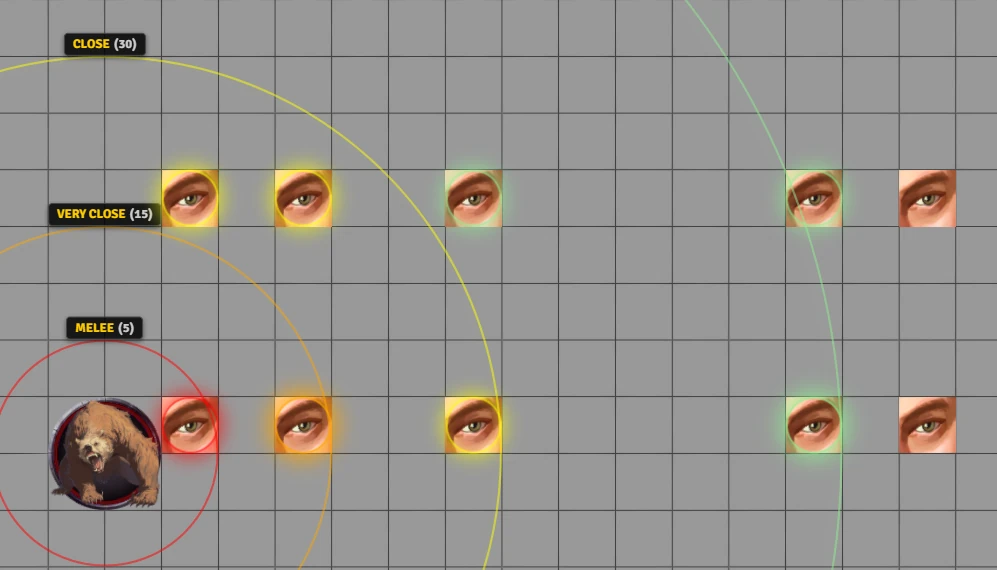
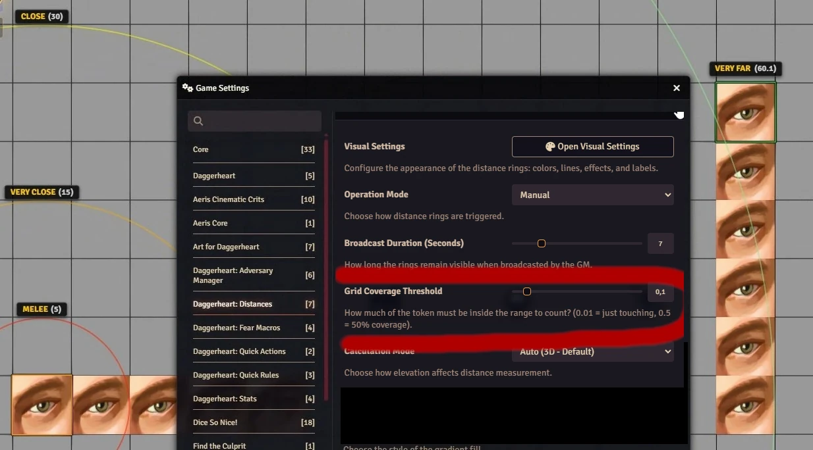
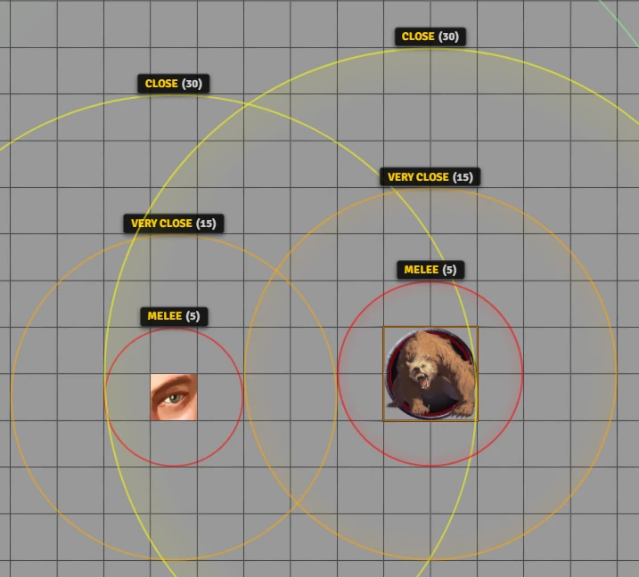
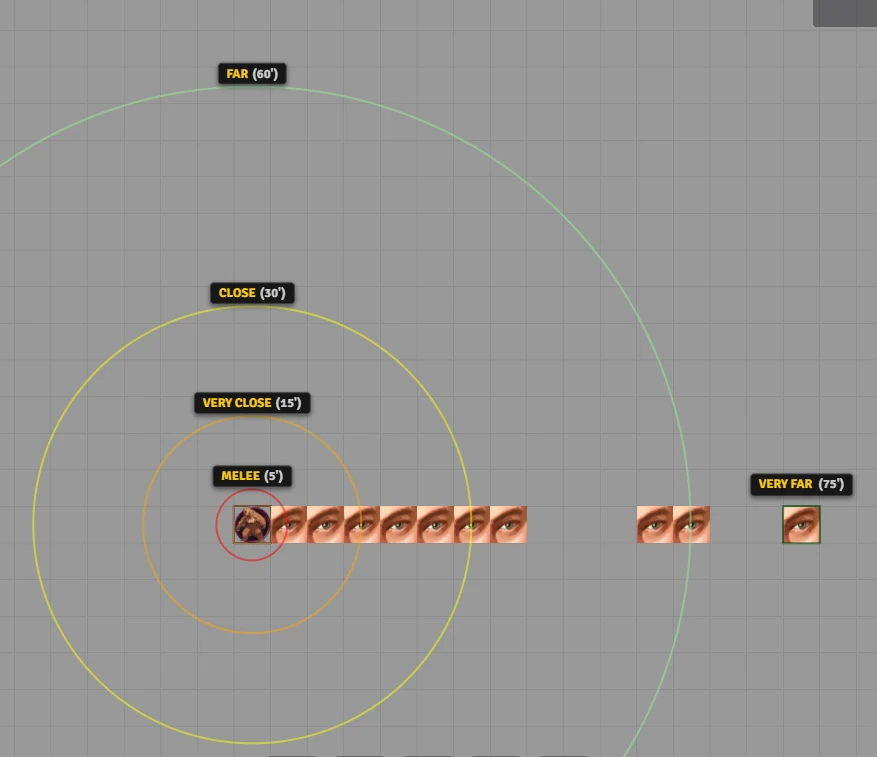
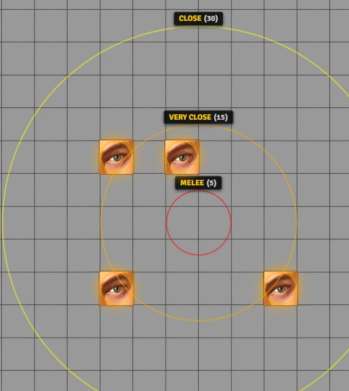
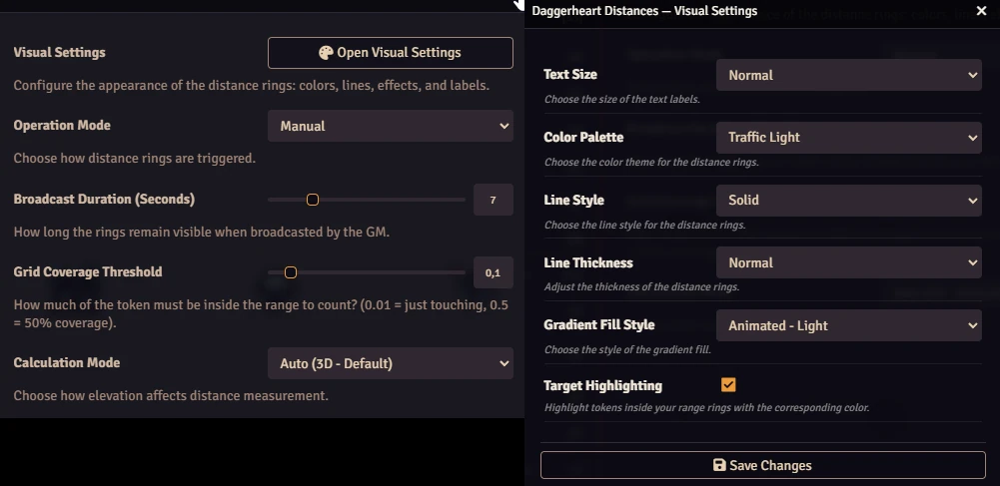

# Daggerheart: Distances

Daggerheart: Distances desenha os quatro anéis de alcance do Daggerheart ao redor de um token (Corpo a Corpo 5 ft, Muito Perto 15 ft, Perto 30 ft, Longe 60 ft) e colore cada um dos outros tokens com a cor do anel em que ele está. Selecione o seu token e passe o mouse sobre outro para ver o alcance e a distância, ou mostre os anéis para todos os jogadores de uma vez.

<video src="https://github.com/user-attachments/assets/c6e6a905-9cd4-4666-b742-9719f91a0a7b" 
       controls 
       width="720"
       autoplay 
       loop 
       muted></video>

[](https://buymeacoffee.com/mestredigital) [](https://mestredigital.online/pages/projetos-en)

> Read in [English](../README.md)

## O que ele mostra

Com os anéis ligados, cada token dentro deles brilha com a cor do menor anel em que está. Tokens além de Longe ficam como estão.

<p align="center"></p>

Selecione o seu token e passe o mouse sobre outro. Um rótulo acima dele mostra o alcance (de Corpo a Corpo a Muito Distante) e a distância em pés. Não é preciso ligar os anéis para isso.

Os anéis começam na borda do token, então o Corpo a Corpo de uma criatura grande vai mais longe a partir do centro dela do que o de uma pequena. Um alvo conta como dentro de um anel quando uma parte suficiente do corpo dele está dentro: 10% por padrão, ajustável em **Limiar de Cobertura da Grade**. Tokens Tiny e Small são medidos pelo tamanho real.

<p align="center"></p>

<p align="center"></p>

Enquanto você arrasta um token, os anéis acompanham a pré-visualização, então dá para testar uma posição antes de soltar.

Os anéis usam sempre 5, 15, 30 e 60 ft. Eles não seguem as distâncias de alcance alteradas nas configurações do Daggerheart.

Quando o Mestre carrega o mundo, o módulo muda a configuração **Show Token Distance on Highlight** do Daggerheart para **Never**, porque o rótulo do módulo substitui o do sistema.

## Mostrando os anéis

<p align="center"></p>

Clique com o botão direito em um token e clique no ícone de círculo no HUD do token, ou use um atalho:

| Atalho | Ação |
|---|---|
| `R` | Liga ou desliga os anéis dos tokens sob o mouse ou selecionados, só para você |
| `Shift+R` | Mostra os anéis para todos os jogadores (apenas Mestre) |
| `M` | Anéis a partir do centro dos tokens selecionados |
| `Shift+Delete` | Remove todos os anéis |
| Segurar `Shift+H` | Modo Hover (Mestre) enquanto as teclas estão pressionadas |
| Segurar `Shift+B` | Modo Hover (Transmissão) enquanto as teclas estão pressionadas |

Todos os atalhos podem ser trocados em **Configurar Controles**.

O **Modo de Operação**, nas configurações do módulo, decide o que faz os anéis aparecerem:

| Modo | O que acontece |
|---|---|
| Manual (padrão) | Os anéis aparecem só com `R` ou com o botão do HUD |
| Modo Hover (Mestre) | Os anéis aparecem no token sob o mouse do Mestre, só na tela do Mestre |
| Modo Hover (Transmissão) | Cada token sob o mouse do Mestre mostra seus anéis para todos os jogadores |

As teclas de segurar mudam o modo só enquanto estão pressionadas. Assim, no Manual, você pode segurar `Shift+B` para mostrar algumas ameaças para a mesa e soltar para voltar.

## Mostrando os anéis para os jogadores

O Mestre pode mostrar os anéis de um token na tela de todos os jogadores. Eles somem depois de 7 segundos, ou do tempo definido em **Duração da Transmissão**. Use `Shift+R`, o Modo Hover (Transmissão) ou `toggle({ remote: true })` pela API. Um jogador que aperta `Shift+R` não faz nada.

Por padrão, `Shift+Delete` remove só os anéis do Mestre. Mude **Modo Limpar Tudo** para Todos os Jogadores para removê-los de todas as telas.

## Medindo a partir de um grupo

Selecione vários tokens e aperte `M`. Os anéis são desenhados a partir do centro do grupo, na elevação média. Com um só token selecionado, `M` funciona como `R`.

<p align="center"></p>

## Elevação

O **Modo de Cálculo** decide se a altura conta:

- Automático (3D): a diferença de elevação entra na distância. É o padrão.
- Plano (2D): a elevação é ignorada.
- Ambos: os alcances usam 3D, e o rótulo do hover mostra a distância 3D e a 2D.

## Configurações

<p align="center"></p>

Estas ficam nas configurações do módulo e só o Mestre pode mudar:

| Configuração | Padrão |
|---|---|
| Modo de Operação | Manual |
| Modo Limpar Tudo (Mestre) | Apenas Mestre |
| Duração da Transmissão (Segundos) | 7 |
| Limiar de Cobertura da Grade | 0.10 |
| Modo de Cálculo | Automático (3D) |

Cada jogador ajusta a aparência dos próprios anéis em **Abrir Configurações Visuais**:

| Configuração | Opções |
|---|---|
| Paleta de Cores | Semáforo (padrão), Semáforo Invertido, Synthwave, Fogo Real |
| Estilo de Linha | Sólida (padrão), Pontilhada, Tracejada |
| Espessura da Linha | Normal (padrão), Grande, Extra Grande, Massiva |
| Estilo de Preenchimento Gradiente | Estático, Animado - Normal, Animado - Leve (padrão), Nenhum |
| Tamanho do Texto | Pequeno, Normal (padrão), Grande |
| Destaque de Alvos | Ligado (padrão) ou desligado |

## Macros e API

Tudo o que os atalhos fazem também pode rodar a partir de uma macro. O módulo não tem compêndio de macros: crie uma macro de script com a chamada que você quer, tirada de [API.md](API.md) (em inglês). Por exemplo, anéis que ignoram a elevação, ou um Limpar Tudo que alcança todos os jogadores.

A mesma página mostra como outros módulos podem perguntar em qual alcance um token está em relação a outro, com a mesma medição que os anéis usam.

## Instalação

Instale pelo navegador de módulos do Foundry VTT, ou use este link de manifesto:

```js
https://github.com/brunocalado/daggerheart-distances/releases/latest/download/module.json
```

Precisa do Foundry VTT v14 e do sistema Daggerheart 2.2.6 ou mais recente.

## Traduções

Para traduzir o módulo para o seu idioma:

1. Baixe o arquivo em inglês: [languages/en.json](https://github.com/brunocalado/daggerheart-distances/blob/main/languages/en.json)
2. Traduza os valores e mantenha as chaves sem alteração.
3. Envie o arquivo em [GitHub Issues](https://github.com/brunocalado/daggerheart-distances/issues) e diga qual é o idioma.

## Changelog

O histórico completo de alterações está no [CHANGELOG](../CHANGELOG.md).

## ⚖️ Créditos e Licença

* **Licença do Código:** [LICENSE](../LICENSE).

* Este módulo é um fork de [este projeto](https://github.com/fsergler/foundry_combat_distances)

**Aviso:** Este módulo é uma criação independente e não tem afiliação com a Darrington Press.

# 🧰 Meus Módulos para Daggerheart

| Módulo | Descrição |
| :--- | :--- |
| 💀 [**Adversary Manager**](https://github.com/brunocalado/daggerheart-advmanager) | Escale adversários instantaneamente e monte encontros equilibrados. |
| 🖼️ [**Art Mapper**](https://github.com/brunocalado/dh-assets) | Atribui artes automaticamente aos compêndios do sistema, atores, tokens e conteúdo de módulos personalizados — mantendo seus visuais organizados e atualizados. |
| 🐉 [**Colossus**](https://github.com/brunocalado/dh-colossus) | Gerencie encontros com chefões massivos de múltiplas partes com HP independente por parte e um único pool de stress compartilhado. |
| 📦 [**Containers**](https://github.com/brunocalado/dh-containers) | Agrupe itens do inventário em contêineres recolhíveis — bolsas, baús, mochilas — para organizar as fichas de personagem. |
| 💥 [**Critical**](https://github.com/brunocalado/daggerheart-critical) | Críticos animados. |
| 💠 [**Custom Stat Tracker**](https://github.com/brunocalado/dh-new-stat-tracker) | Adicione rastreadores personalizados aos atores. |
| ☠️ [**Death Moves**](https://github.com/brunocalado/daggerheart-death-moves) | Aprimora o momento do Movimento de Morte com uma interface dramática e automação completa. |
| 📏 [**Distances**](https://github.com/brunocalado/daggerheart-distances) | Visualiza alcances de combate com anéis personalizáveis e cálculos por hover. |
| 📦 [**Extra Content**](https://github.com/brunocalado/daggerheart-extra-content) | Pacote de conteúdo homebrew. |
| 😱 [**Fear Tracker**](https://github.com/brunocalado/daggerheart-fear-tracker) | Adiciona uma barra deslizante animada com tokens de medo configuráveis à interface. |
| 🧟 [**Horde**](https://github.com/brunocalado/dh-horde) | Divida tokens de horda em dezenas de tokens individuais e gerencie o movimento e os atributos automaticamente. |
| 🎁 [**Mystery Box**](https://github.com/brunocalado/dh-mystery-box) | Introduz mecânicas de caixa misteriosa para saque aleatório e surpresas. |
| ⚡ [**Quick Actions**](https://github.com/brunocalado/daggerheart-quickactions) | Acesso rápido a mecânicas comuns como Dano por Queda, Tempo Livre, etc. |
| 📜 [**Quick Rules**](https://github.com/brunocalado/daggerheart-quickrules) | Guia de referência rápido e acessível para as regras principais. |
| 🤖 [**Resource Macros**](https://github.com/brunocalado/daggerheart-fear-macros) | Executa macros automaticamente quando os recursos de Medo, Esperança, Estresse, PV ou Armadura mudam. |
| 🎲 [**Stats**](https://github.com/brunocalado/daggerheart-stats) | Registra as rolagens de dados do Mestre e dos Jogadores. |
| 🧠 [**Stats Toolbox**](https://github.com/brunocalado/dh-statblock-importer) | Importe atores usando um bloco de estatísticas. |
| 🛒 [**Store**](https://github.com/brunocalado/daggerheart-store) | Uma loja dinâmica, interativa e totalmente configurável dentro do jogo. |
| 🔍 [**Unidentified**](https://github.com/brunocalado/dh-unidentified) | Oculta nomes e descrições de itens até que sejam identificados pelos jogadores. |
| 🌌 [**Void**](https://github.com/brunocalado/the-void-unofficial) | Módulo não oficial que traz o conteúdo de playtest de The Void — classes, subclasses, ancestralidades, comunidades, adversários, saques, armas experimentais e mais. |

# 🗺️ Aventuras

| Aventura | Descrição |
| :--- | :--- |
| ✨ [**I Wish**](https://github.com/brunocalado/i-wish-daggerheart-adventure) | Um rico mercador está amaldiçoado; uma expedição final pode ser a única esperança. |
| 💣 [**Suicide Squad**](https://github.com/brunocalado/suicide-squad-daggerheart-adventure) | Criminosos forçados a servir um mestre implacável em uma terra à beira da guerra. |
